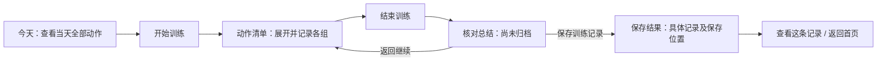

# 健身记录：先理顺流程，再调整页面

日期：2026-10-05。状态：交互提案，供用户检查；不是已实现或已通过真机验收的功能说明。

> 同日用户追加要求后，交互方案由 [每日训练、照片日志与微信登录](FITNESS_DAILY_FLOW.md) 替代：动作完成自动推进，最后统一提交后看总结，增加照片日志和微信登录。下文保留为上一轮分析记录，不再按“动作不自动跳转、先总结后保存”实施。

## 1. 这次要解决的问题

用户实测反馈：排版混乱；多个动作之间关系不清楚；只有逐组填表的感觉；找不到结束入口；提交总结后没有可理解的变化。本轮先确认流程，不继续叠加功能或重写业务。

代码检查能确认的事实：

- 小程序 `pages/workout/index.wxml` 用横向动作标签和一个当前动作面板；标签只显示名称，没有每个动作的完成进度。其他动作的状态不可同时看到。
- 替换、调整目标、移动、备注、移除等管理操作直接铺在记录面板里。“查看总结”位于这些控件和目标清单之后，没有常驻结束入口。
- 训练、总结、保存结果共用同一个页面，通过 `reviewing`、`saved` 条件切换；`finish()` / `save()` 没有显式的滚动复位。是否因此造成此次手机上的“无变化”尚未复现，不能认定为根因。
- 当前有两步：`finish()` 查看总结，`save()` 保存。`save()` 只有在 `store.commit()` 返回成功后才切换结果视图。现有 `commit()` 包含本地更新和同步，不代表所有失败都等于没留下任何内容。
- 总结的实际组从 `done` 组提取。填写数值与确认完成是两个动作；这个区别目前解释和反馈不足。
- 本轮运行 `bun test miniprogram-tests/workflow.test.js --test-name-pattern '暂停、稍后继续'`：1 项通过、15 项过滤。该测试模拟存储并直接调用处理器，且该场景没有真实动作组，不能复现或排除用户反馈的多动作手机提交问题。

“提交总结后无变化”的环境、具体按钮、保存前后页面和错误状态仍待核对。此文不声称修复该故障。

## 2. 统一概念

固定层级：**每周计划 → 某一天的训练安排 → 多个动作 → 每个动作的多组目标**。

例如：每周四练；周一安排“胸和三头”，包含卧推 3 组、上斜哑铃推举 3 组、绳索下压 3 组；周三安排“背”，也包含多个动作。

- 周一至周日，每一天最多一个计划安排，一周最多七个；不是一周只能一个安排，也不是一天只能一个动作。
- 计划中设置动作及目标组数、时长目标，不填写这次的实际重量和次数。
- 开始一次训练时复制当天安排；训练中记录实际数据，只改本次内容。
- 每组确认表示“这一组确实做过”；整个训练只需统一保存一次。
- “保存了一条训练记录”和“达成这天全部计划目标”是两个结果。部分完成也能保存。
- 已有严格达标规则保持：不同记录不合并目标，额外组不顶替缺项，空目标不能达标，历史按自己的目标快照判断。

## 3. 唯一主要流程



总结是核对步骤，尚未归档；训练过程可以自动保留草稿。避免用同一个“已保存”同时表示草稿保留和最终记录归档。

每一步只有一个主要动作：开始训练、结束训练、保存训练记录、查看本次记录。次要操作用文字或菜单呈现。

## 4. 页面职责与排版

### 今天

先显示今天练什么、几个动作和目标几组，再显示“开始训练”。下面放紧凑的一周安排和本周计划达标 / 实际训练次数。临时训练与补录作为次要入口。

有草稿时主要入口改成“继续训练”，同时显示动作和组数进度；不悄悄新建另一份草稿。

### 周计划和单日编辑

周概览七行：星期、安排名称、动作数；休息日明确显示“休息”。点击一天，显示完整动作列表，例如“卧推 · 3 组”。添加动作允许一次选多个。

单日页面主要编辑动作和目标；备注、移动、删除收入该动作的“更多”。返回周概览保留草稿，整份计划统一保存。交换星期展示双方变化再确认。

### 训练中：当天动作清单

采用纵向可折叠的动作清单，不再把所有动作的状态仅藏在横向标签里。标题示例：

```text
周一 · 胸和三头             训练用时 18:32
目标已完成 4/9 组           已保留草稿

卧推                 3/3 组   已完成     更多
上斜哑铃推举         1/3 组   进行中     更多
  第1组    20 kg    10次      已完成
  第2组    [重量]   [次数]    确认这组
  第3组    [重量]   [次数]    确认这组
  添加一组
绳索下压             0/3 组   未开始     更多

添加动作

休息 00:45          暂停 / 展开
稍后继续                    结束训练
```

默认展开第一个未完成动作，其他标题和进度保留；可以任意展开并切换，不强迫按顺序。完成一个动作后提供“下一个动作”，不自动跳走打断用户。

常见操作仅保留：输入实际值、确认这组、添加组、添加动作、结束训练。替换、调整目标、移动、备注和移除进入“更多”。

组状态分清：未填写、已填写待确认、已完成。上次数据作为提示，不自动当成本次完成。允许明确点击“沿用上一组数据”，确认完成仍由用户触发。

时长动作显示目标和实际秒数。实际 20 秒并确认、目标 30 秒：记录已完成的一组实际训练，但目标仍未达标，标题应写清“实际 1 组，目标达标 0/1”，不能只打一个模糊的勾。

### 常驻操作区域

结束训练入口常驻底部；休息条在其上方，使用同一套布局管理，不能互相遮住。动作菜单不常驻底部。

键盘弹出时只保持紧凑的“完成输入”操作；收起后结束训练按钮恢复原位。页面自动给当前输入留出可视空间。具体键盘方案在低保真版本与真机一起验证后定稿，不能仅凭 CSS 推断通过。

## 5. 结束、总结和保存

点“结束训练”后停止总计时、结束休息，进入有明确标题的总结视图并回到顶部。建议作为独立页面/视图呈现，避免长表单底部原地切换但用户看不到变化。

存在已填却未确认的组时，先列出具体动作和组号，提供“返回检查”以及“仅保存已确认组”；不默默丢弃输入，也不自动认定已完成。只有尚未填写的目标组不需要逐个报错。

总结按优先级显示：日期、训练名称、实际动作数和组数、用时、各动作摘要、缺项。感受、备注、校正用时均为可选，不能填完这些才允许保存。校正用时用分钟和秒，避免要求用户心算总秒数。

底部主按钮统一叫“保存训练记录”，次按钮“返回继续训练”。部分训练在上方明确提示“已完成 6/9 个目标组，仍可保存”，无需变换按钮含义。

保存后必须进入可理解的结果：

- 本机持久化成功：显示“记录已保存到此设备”、具体动作/组数、训练时间；历史可找到该记录。
- 登录且同步成功：显示“已同步到账号”。
- 已可靠保存到账号隔离的本机待同步队列、网络失败：显示“已保存到此设备，尚未同步”，提供重试。不能仅凭内存更新就给出此提示；实施前须验证持久队列可靠保存。
- 本机也保存失败：留在总结，明确“未能保存”，保留当前输入，提供重试。不能跳成功页。
- 版本冲突：保留本次内容，提示需处理同步冲突，禁止直接覆盖云端版本。

保存结果同时说明计划状态，例如：“记录已保存；周一安排部分完成，绳索下压还差 3 组。”首页实际训练次数增加，计划达标数可以不变，但原因必须可见。

结果提供“查看本次记录”（直达该条详情）和“返回首页”。重复点击与重试共用原记录身份，不新增重复记录。历史编辑使用“保存修改”，成功更新原条目。

无有效完成组时，明确询问“保留草稿”或“仅打卡”；仅打卡不冒充完整训练。已有实际组但目标未达标时直接允许部分保存。

## 6. 灵活调整时，用户看到什么

- 替换动作：先展示已完成数据保留、新动作承担剩余目标的结果，再确认。
- 移除动作：以简单说明区分“移除记录”和“取消剩余训练目标”。涉及减少目标时必须确认，不能把内部关联规则整段铺在训练主界面。
- 临时添加：默认计实际训练；菜单里可明确加入本次目标。
- 修改周计划：只改变以后开始的训练；本次临时调整不自动更新计划。
- 稍后继续：暂停总计时并持久保留草稿，下次继续同一条。

## 7. 记录与统计

记录列表优先显示最近保存的训练，点开立即看到多个动作及实际组；大图表放到统计入口或展开区，避免用户保存后还要越过数屏图表才能确认结果。

首页明确分开“计划达标 X/Y”与“实际训练 N 次”。一周状态区分待练、部分、达标、调整后达标和休息。数据图继续展示真实重量/次数/秒数；是否增长不影响保存反馈。

## 8. 参考来源与采用边界

- [Hevy：计划模板与实际训练的区别](https://help.hevyapp.com/hc/en-us/articles/33703513582871-Workouts-vs-Routines-in-Hevy-What-They-Mean-and-How-to-Use-Them)：官方明确区分可复用 routine 和现场记录 workout。本方案据此强化页面职责，不更换现有技术栈。
- [Hevy：记录训练步骤](https://help.hevyapp.com/hc/en-us/articles/35361530647959-How-to-Log-a-Workout-in-the-Hevy-App-Step-by-Step-Guide)：空白训练、从计划开始、记录后 Finish 都有明确入口。我们采用清晰主流程；严格目标达标沿用本项目规则。
- GitHub 项目与第一方实现研究见 [FITNESS_WORKFLOW_REFERENCES](FITNESS_WORKFLOW_REFERENCES.md)。纵向折叠清单、独立保存结果和本机/同步文案是本项目提案，不能声称照搬某个项目已验证适用于微信。

不导入第三方代码或替换框架；借鉴交互时仍需验证微信键盘、滚动和生命周期差异。

## 9. 实施顺序与验收门槛

1. 用户检查本方案的层级、动作清单、结束/保存步骤和实际保存反馈。
2. 做最小可点击低保真流程：当天三个动作 → 填组 → 切换动作 → 结束 → 总结 → 保存结果 → 原记录。覆盖部分完成和失败视图，清楚标注演示数据；暂不精修颜色和图表。
3. 用户能够不看说明完成流程后，接入现有小程序真实数据；先补齐提交无变化的可复现场景，再实施针对性修复。React 使用相同交互语义。
4. 开发侧录制或逐步核验页面操作：从新建计划到保存重开，每一步都能看到预期变化；通过处理器测试不算页面验收完成。
5. 最后打磨视觉并进行真机确认。用户参与操作体验验证，开发侧承担复现、定位和回归，不把发现全部问题的责任交给用户。

最低验收脚本：周一三个动作各两组；完成第一个动作两组、第二个一组、第三个未练；结束后显示实际 3 组、目标 3/6；保存后出现明确结果，历史有且仅有一条、重开数据相同、周一部分完成。再验证全部达标、填了未确认、时长未达标、仅打卡、断网与重试、账号隔离及退出恢复。

布局分别核验：320–430px、长动作名称、多个动作、键盘弹出、休息展开。任何状态下都有清楚的下一步；主按钮、输入和错误反馈互不遮挡。

## 10. 本轮边界

本轮仅做代码阅读、外部资料调研、流程提案和验收状态更正，没有修改运行中的训练页面，没有迁移或清理用户训练数据，没有验证用户手机提交故障已解决。
